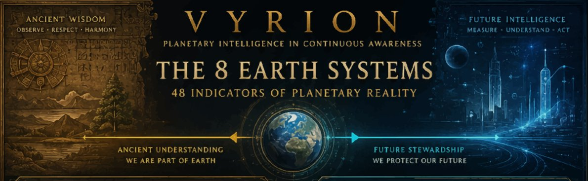

# VYRION

## Planetary Intelligence in Continuous Awareness

**Measure What Matters.**
**Trust Evidence Over Narrative.**
**Verification Over Speculation.**

🌍 Platform: https://vyrion.earth
📡 Intelligence Network: https://vyrion.earth
📧 Contact: [contact@vyrion.earth](mailto:contact@vyrion.earth)

---

## What Is VYRION?

VYRION is a planetary intelligence platform designed to measure, verify, and communicate signals relevant to environmental stability, corporate accountability, systemic risk, and planetary health.

The platform combines public data, scientific research, environmental monitoring, and accountability frameworks into a unified intelligence network designed to make complex realities more visible, understandable, and actionable.

VYRION exists to help answer a simple question:

> What is actually happening, and how do we know?

**Current state:** the VYRION Index reads **49.2 / 100** — the restated baseline under methodology v1.1 (March 2026; see docs/RESTATEMENT-NOTE-V1.1.md), recomputed monthly from published inputs across **8 Index systems** and **49 indicators**. CONSCIENCE v2.9 scores **36 companies** (16 Breach · 15 Warning · 5 On Track · Corporate Pledge Integrity Score mean 35.7) on pledge-vs.-reality alignment. The platform is an installable app (phone · tablet · desktop).

---

## The VYRION Network

Eight interconnected modules form the operational foundation of the VYRION ecosystem.

### ATLAS

**Planetary Intelligence**

Environmental monitoring, Earth-system analysis, and global condition awareness. Publishes the monthly VYRION Index.

### SHIELD

**Disaster Intelligence**

Early warning systems and risk detection for emerging environmental threats.

### ROOT

**Regenerative Systems**

Intelligence for soil health, food security, land restoration, and agricultural resilience.

### CANOPY

**Habitat Restoration**

Reforestation, biodiversity recovery, and ecosystem restoration intelligence.

### FLUX

**Energy Transition**

Clean energy deployment, infrastructure intelligence, and emissions reduction pathways.

### TIDE

**Ocean & Water Systems**

Monitoring and restoration of freshwater, marine ecosystems, and water security.

### LOOP

**Circular Resource Intelligence**

Material lifecycle tracking, waste reduction, and circular economy systems.

### PULSE

**Impact Economy Infrastructure**

Verification, incentives, and value systems designed to support measurable planetary restoration.

---

## Experiences

Beyond operational intelligence, VYRION includes public-facing experiences designed to make complex systems understandable and accessible.

### CONSCIENCE

Corporate accountability intelligence.

Tracks alignment between public commitments and publicly observable outcomes using transparent methodologies and evidence-based evaluation. v2.9 covers 36 companies across four public factors — no proprietary or self-reported-only data enters the score.

### MISSION CONTROL

The human network behind the Index.

Founder seat, regional node leads, and open positions — the people turning planetary signal into local action.

### NEXAN

Systems exploration environment.

A conceptual framework for navigating interconnected planetary challenges and solutions.

### EXPLAINARIUM

Public learning and visualization platform.

Transforms complex environmental, scientific, and societal data into understandable narratives and interactive experiences — with guided learning tracks for ages 8 to adult.

---

## THE RECORD

THE RECORD is VYRION's public accountability publication.

Each issue examines a specific organization, commitment, initiative, or systemic challenge through documented evidence, source verification, and transparent methodology.

The objective is not advocacy.

The objective is visibility.

---

## Core Principles

### Evidence First

Claims should be supported by verifiable evidence. No unlabeled simulated data — ever.

### Continuous Verification

Understanding evolves as new information becomes available.

### Transparency

Methods, assumptions, and sources should be visible whenever possible.

### Accountability

Commitments matter. Outcomes matter more.

### Planetary Perspective

Environmental, social, and economic systems are interconnected and should be understood as such.

---

## Open Documentation

VYRION publishes documentation covering:

* Methodologies
* Architecture
* Research frameworks
* Governance principles
* Accountability standards
* Public disclosures

Documentation is available within the repository and continues to evolve alongside the platform.

---

## The Mission

VYRION LLC was filed in Hawaii in October 2026 to build infrastructure for planetary awareness, accountability, and decision-grade intelligence — and to keep it independent while doing so.

The goal is not to control information.

The goal is to improve visibility.

The goal is not prediction for its own sake.

The goal is informed action grounded in evidence.

---

## Contributing

Constructive feedback, corrections, research collaboration, and methodological review are welcomed.

If you identify an error, inconsistency, or omission, please contact:

[contact@vyrion.earth](mailto:contact@vyrion.earth)

Verification improves through scrutiny.

---

## VYRION

**Planetary Intelligence in Continuous Awareness**

Measure What Matters.
Trust Evidence Over Narrative.
Verification Over Speculation.

https://vyrion.earth
